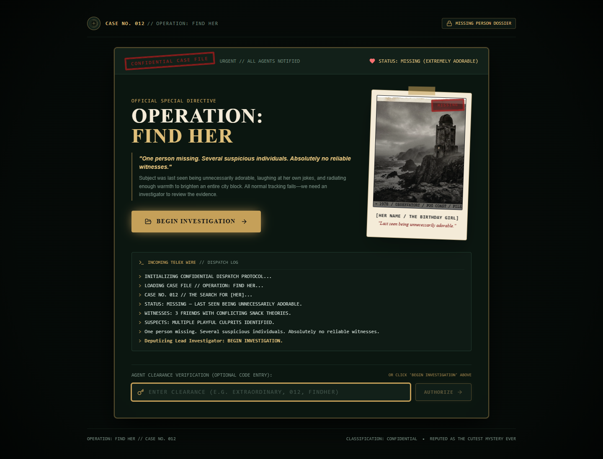
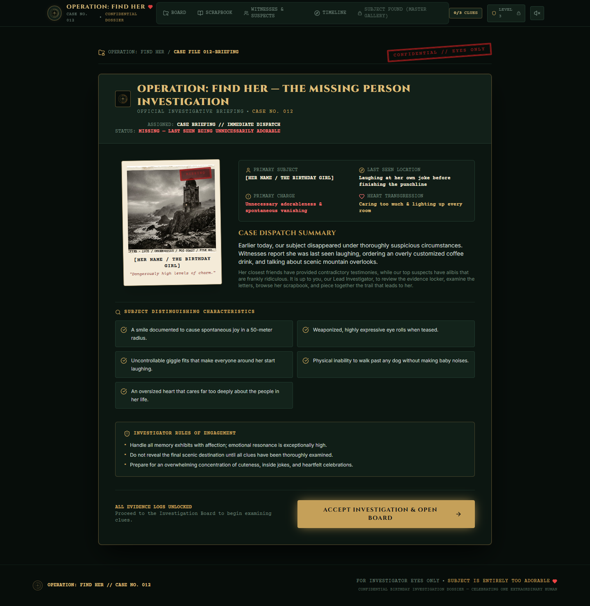
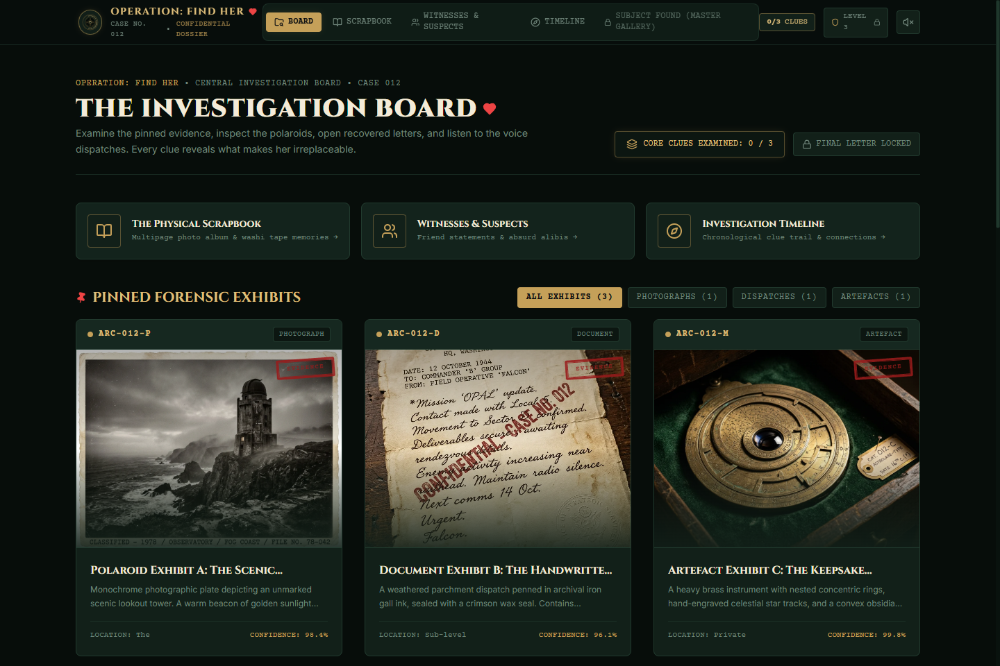
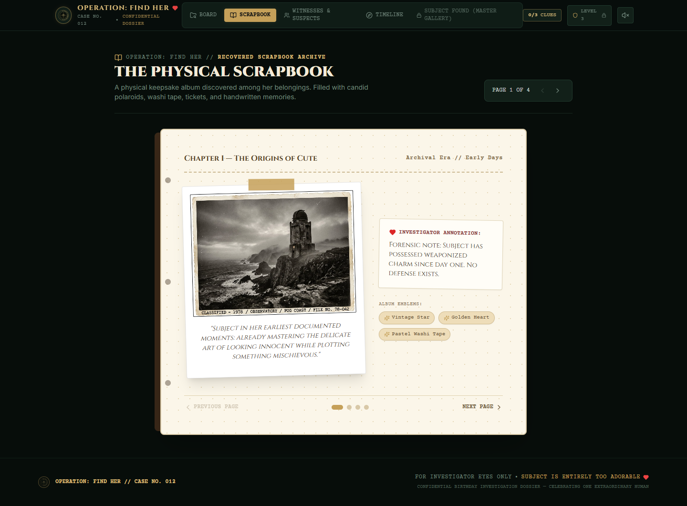
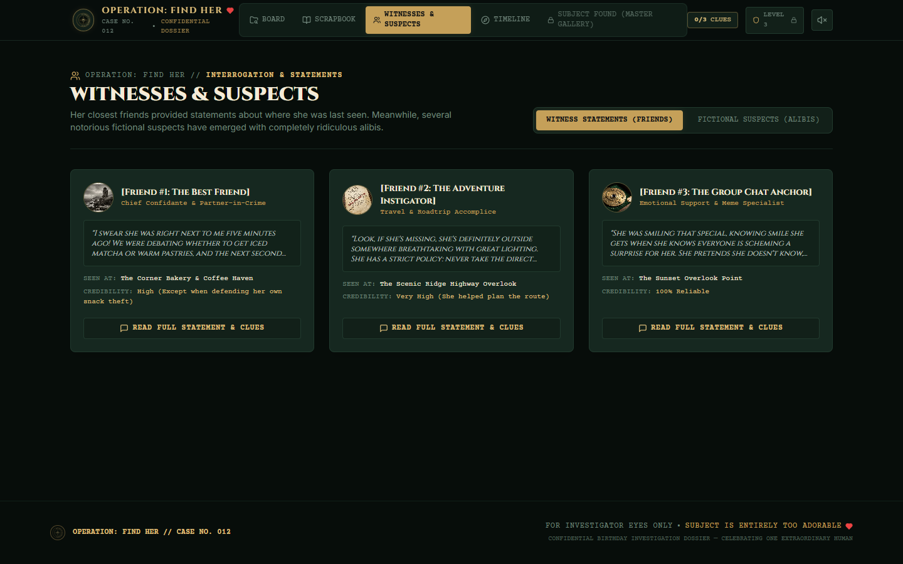
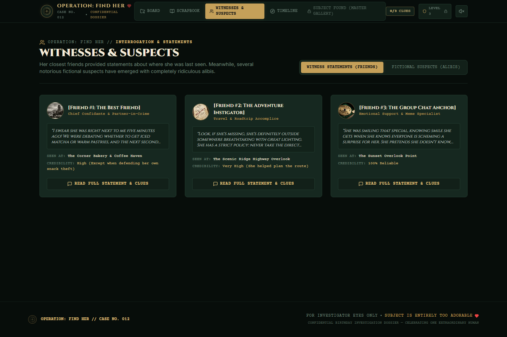
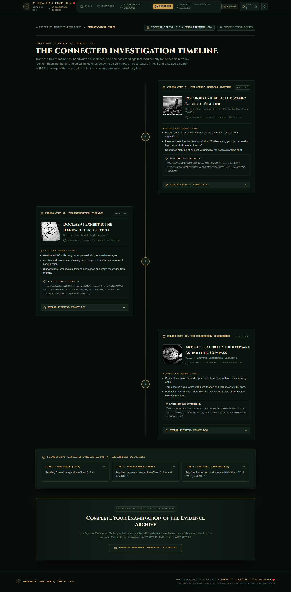
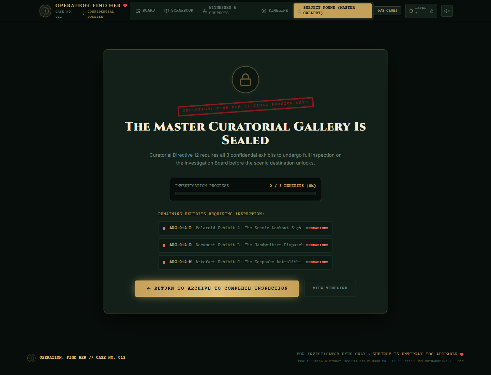
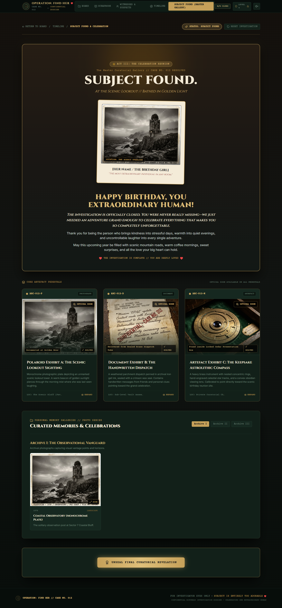
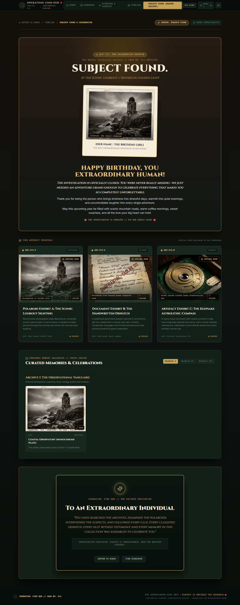

# Operation: Find Her — Visual Gallery & Tour (`view/`)

This directory contains full-resolution captures of every screen, hub, and interactive dialog in the **Operation: Find Her** missing-person birthday experience.

---

### 1. Screen A — Access Terminal & Case File Entry

*Classified case folder landing featuring the typewriter teletype stream, missing person polaroid placeholder ("Last seen being unnecessarily adorable"), clearance code verification, and direct "BEGIN INVESTIGATION" button.*

---

### 2. Screen B — Case Briefing Dossier

*Official investigative briefing outlining the subject's distinguishing characteristics (infectious laughter, inability to pass a puppy, coffee addiction), strict rules of engagement, and "ACCEPT INVESTIGATION & OPEN BOARD" transition.*

---

### 3. Screen C — Central Investigation Board

*Tactile corkboard investigation hub integrating pinned photographic polaroid exhibits, wax-sealed correspondence letters, vintage cassette deck audio player, and color-coded investigator sticky notes.*

---

### 4. Interactive Wax-Sealed Letter Modal

*Envelope inspection modal with an interactive broken wax seal and unfolded stationery penned in handwriting font.*

---

### 5. The Physical Scrapbook

*Multi-page tactile album with washi tape corners, postal stamps, handwritten annotations, memory photos, and page-turning controls.*

---

### 6. Witnesses & Suspects Hub

*Dedicated hub featuring heartfelt witness recollections from real friends alongside playful fictional suspects (e.g., The Notorious Snacking Syndicate, The Cat Who Knows Too Much).*

---

### 7. Suspect Cross-Examination Interrogation Dialog

*Interactive interrogation modal with alibi cross-examination, suspect dialogue, and unlocked contradiction clues.*

---

### 8. Chronological Clue Trail Timeline

*Chronological milestone timeline demonstrating active narrative connections and syntheses as exhibits are examined.*

---

### 9. Master Curatorial Gallery — Locked Gate State

*Curatorial gate blocking access until all 3 core forensic exhibits are examined on the investigation board.*

---

### 10. Act III: Subject Found at the Scenic Overlook

*The grand reveal: the subject is found at the scenic overlook bathed in warm golden light, featuring her hero portrait, triple artifact pedestals with optical zoom, and curatorial photo collections.*

---

### 11. Act III: Unsealed Birthday Dedication Revelation

*The final curatorial revelation unsealed: heartfelt birthday dedication, celebrating her as irreplaceable and deeply loved.*
